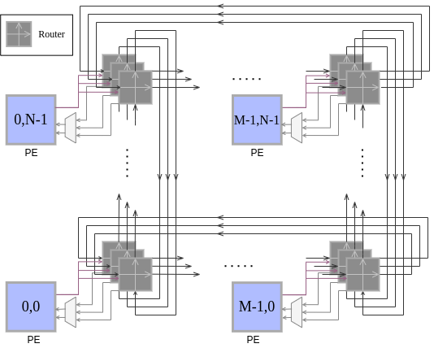
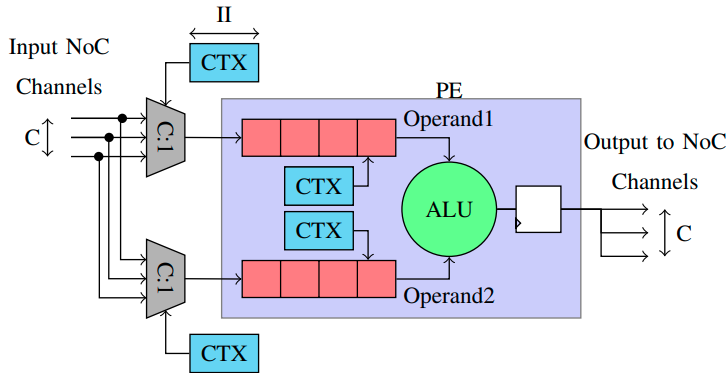
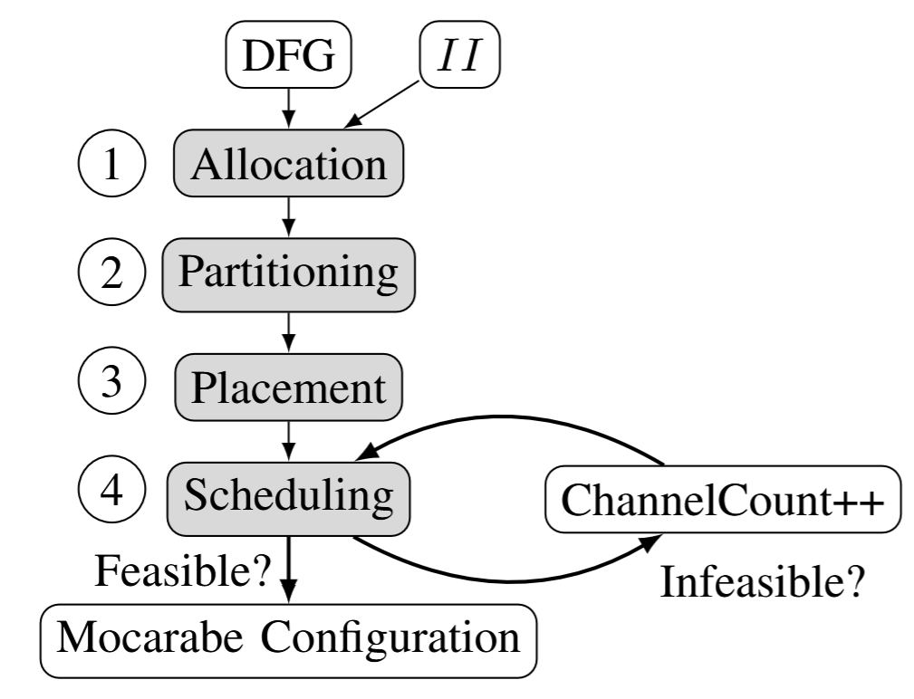

# Mocarabe

[](https://github.com/gigeresk/mocarabe/actions/workflows/ci.yml)  

Mocarabe is a CGRA (Coarse-Grained Reconfigurable Array) architecture generator and a fully-custom toolchain. The implementation and results are discussed in [Mocarabe: High-Performance Time-Multiplexed Overlays for FPGAs](https://ieeexplore.ieee.org/document/9444076), published at FCCM 2021. This work was done by Frederick Tombs, Alireza Mellat, and Prof. Nachiket Kapre.

To get started, jump to [Toolchain setup](#toolchain-setup).

## Architecture 
The architecture consists of a grid of building blocks connected by a unidirectional torus network, as shown in the figure below. Each block contains a processing element (PE) to execute operations on incoming data and a set of NoC routers to control data movement.  

  

PEs store incoming operands in shift registers and select the relevant stored operands as inputs to their ALU at each cycle, as seen below.



The architecture is designed for statically-scheduled, time-multiplexed sharing of both routing and compute resources, with a repeating context window of length *II* (for *initiation interval*). *II* is the number of cycles in the modulo schedule found by the compiler. This makes the architecture periodic in both space (toroidal topology) and time (modulo schedule).

## Toolchain
The toolchain:
- Compiles a C kernel into a DFG
- Generates a right-sized architecture by allocating PEs, or maps onto a fixed device you describe
- Partitions nodes into processing elements
- Places these PEs in the grid to minimize communication cost (wirelength)
- Schedules routing and computation
- Generates both synthesizable RTL and simulation artifacts.  

Placement is done with simulated annealing and scheduling has dual strategies: an integer linear programming formulation (default) and a temporal-spatial PathFinder implementation.



### Toolchain setup
```
python3 -m venv .venv
source .venv/bin/activate
pip install -e .[dev]

# install icarus verilog. e.g. on Ubuntu:
sudo apt install iverilog

make -C llvm_pass  # build the LLVM plugin
```
### Quick example
Here is a C kernel we can map:
```c
// int_adder_chain.c

int int_adder_chain(int x, int y, int z, int a, int* ret) {
	*ret = x+y+z+a;
}
```
Compile to a DFG, then map and simulate:
```bash
# Compile C kernel to hypergraph DFG
./llvm-with-clang.sh int_adder_chain.c hgr/

# Map to a Mocarabe architecture
  #   -II 1      : initiation interval (schedule length in cycles)
  #   -C 2       : physical channels per NoC link to start with
  #   --max_C 8  : if scheduling fails, raise C up to 8
  #   -iod 1     : IO-node packing density (1 IO node per PE)
  #   -ard 1     : arithmetic-node packing density (1 op per PE)
mocarabe -dfg hgr/int_adder_chain -II 1 -C 2 --max_C 8 -iod 1 -ard 1

# Visualize the placed-and-routed design
mocarabe-viz --proj proj/int_adder_chain_*/

# Simulate the generated RTL (path printed by the command above)
cd proj/int_adder_chain_*/rtl/
iverilog -g2012 -o sim.vvp mocarabe.sv pe_2_input.sv torus_switch.sv \
          pe_srl.v pe_mux_2_input.sv pe_mux_3_input.sv pe_mux_n_input.sv \
          cfg_loader.sv cfg_row.sv pe_cfg.sv SRL16E.v SRLC32E.v SRL64.v mocarabe_tb.sv
vvp sim.vvp
```

### Mapping options
- **Channels.** The scheduling ILP grows with the channel count, so a large `-C`
  often runs out of solver time (`--sched_time`, default 30 s) rather than being
  infeasible. Start low and let `--max_C` raise it; most benchmarks schedule at C=2–4.
- **Fixed device.** `--device devices/tt_3x3_1mul.json` maps onto a device you
  describe instead of a right-sized one. The file draws the PE grid top row first,
  with `+` (adder), `*` (multiplier) and `IO` cells:
  ```json
  {"name": "tt_3x3_1mul",
   "grid": ["IO  +   IO",
            "+   *   + ",
            "IO  +   + "],
   "channels": 2}
  ```
  A PE runs at most II nodes per schedule, so e.g. two multiplies on one `*` PE
  need `-II 2`; the tool checks this before placement.
- **Hard or soft bitstream.** Every project carries both. The *hard* bitstream
  bakes the schedule into the RTL with `$readmem` (smallest, one kernel per chip).
  The *soft* bitstream loads it at run time: hold `cfg_en` low for a clock, then high, and send
  `bitstream.hex`, one `--cfg_width`-bit word per clock on `cfg_data` (so
  `cfg_width + 1` pins), then pulse `rst` and run. Its memories hold `--ii_max`
  schedule slots (or the device file's `ii_max`) and the bitstream sets the II
  actually used. Pick the default with `--bitstream soft`, or per simulation with
  `iverilog -DBITSTREAM_SOFT=1`.
- **Wide input fanout.** Each PE input buffers operands in a 64-deep FIFO. If one
  input feeds consumers more than 63 cycles apart (e.g. Horner-form polynomials),
  `--split_input_fanout` gives each consumer its own copy of that input.
- **Datapath size.** `--data_width` (default 32) sets the PE datapath width, and
  `--fifo_depth` (16, 32 or 64) sets the operand FIFO depth. Each operation adds
  roughly `--pe_pipe` (default 5) + 7 cycles of latency, so with a 16-deep FIFO an
  input that skips an operation level may not fit; a shorter `--pe_pipe` helps.
- **Shared IO (a chip's pins).** `--shared_io` makes every IO PE read one input bus
  and sends the outputs to the `io_out` port, so each input and each output needs
  its own schedule slot (II at least the number of inputs and of outputs). The
  scheduler enforces this. The project gets `io_schedule.json`, which gives the cycle
  each input is sampled and each output appears, and the testbench drives
  `io_stream.hex`. Constants count as inputs.
- **TinyTapeout.** `python -m mocarabe.tt_export proj/<name>/rtl/ <tt repo> --tiles 3x2`
  copies a soft, shared-IO project with at most 8-bit data and configuration words
  into a [TinyTapeout template](https://github.com/TinyTapeout/ttsky-verilog-template)
  clone. It adds the wrapper `tt_um_gigeresk_mocarabe`, a cocotb test that programs
  the chip and checks its outputs, `info.yaml` and the docs. Pins: `ui_in` carries
  config words and then inputs, `uio[0]` is `cfg_en`, `uo_out` is the output and
  `uio[1]` is `out_valid`. The demo:
  ```bash
  mocarabe -dfg hgr/int_level1_linear -II 4 -iod 4 -ard 4 -C 2 --max_C 6 --sched_method ILP \
           --shared_io --data_width 8 --fifo_depth 16 --pe_pipe 2 --bitstream soft --cfg_width 8
  ```


## How to Cite

If you use any part of the code or data from this repository for academic work, please cite the associated paper as follows:

```bibtex
@INPROCEEDINGS{9444076,
  author={Tombs, Frederick and Mellat, Alireza and Kapre, Nachiket},
  booktitle={2021 IEEE 29th Annual International Symposium on Field-Programmable Custom Computing Machines (FCCM)},
  title={Mocarabe: High-Performance Time-Multiplexed Overlays for FPGAs},
  year={2021},
  doi={10.1109/FCCM51124.2021.00021}
}
```
